# 🏗️ Ecommerce Project — Architecture Diagrams

---

## 1. 📋 Overall System Architecture

```mermaid
graph TB
    subgraph Frontend["🖥️ Frontend (React + Vite)"]
        UI[User Interface]
        CTX[ShopContext\nGlobal State]
        AX[Axios HTTP Client]
    end

    subgraph Backend["⚙️ Backend (Node.js + Express)"]
        SRV[server.js\nExpress App]
        MW[Middleware\nauthUser / adminAuth / multer]
        subgraph Routes
            UR[/api/user]
            PR[/api/product]
            CR[/api/cart]
            OR[/api/order]
            CHR[/api/chat]
        end
        subgraph Controllers
            UC[userController]
            PC[productController]
            CC[cartController]
            OC[orderController]
            CBC[chatbotController]
        end
    end

    subgraph ExternalServices["☁️ External Services"]
        MDB[(MongoDB Atlas)]
        CLD[Cloudinary\nImage Storage]
        STR[Stripe\nPayment Gateway]
        GEM[Gemini AI\nREST API]
        EML[Email Service\nNodemailer]
    end

    UI --> CTX --> AX --> SRV
    SRV --> MW --> Routes
    UR --> UC
    PR --> PC
    CR --> CC
    OR --> OC
    CHR --> CBC

    UC --> MDB
    PC --> MDB
    PC --> CLD
    CC --> MDB
    OC --> MDB
    OC --> STR
    CBC --> GEM
    UC --> EML
```

---

## 2. 🔐 User Registration Flow

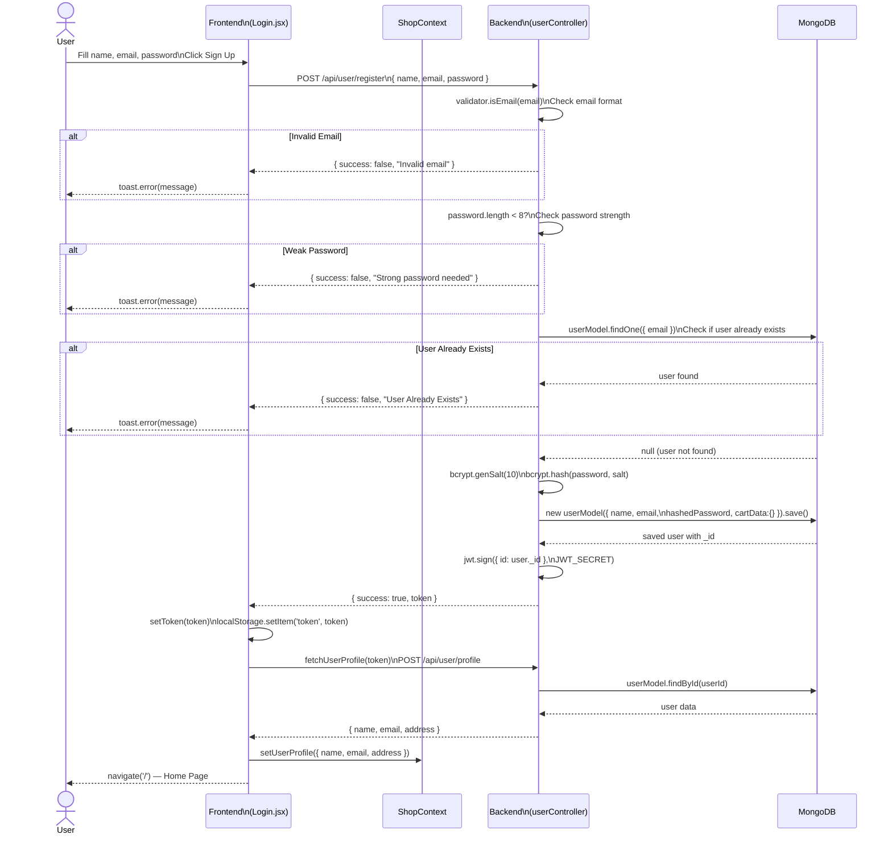

---

## 3. 🔑 User Login Flow

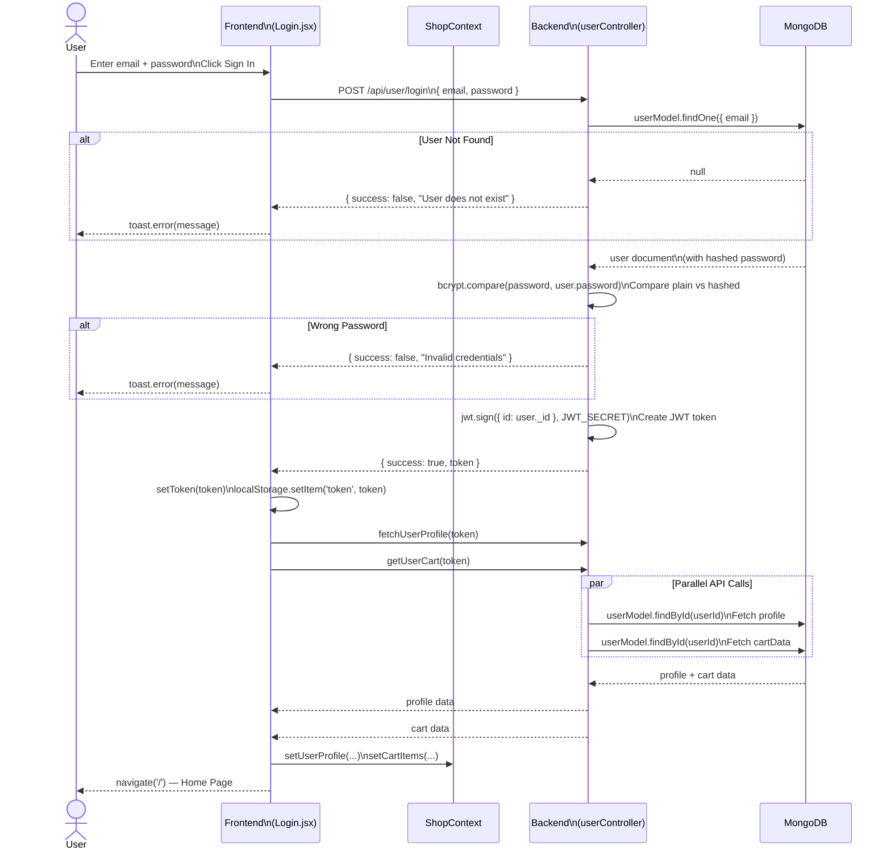

---

## 4. 🔒 JWT Auth Middleware Flow

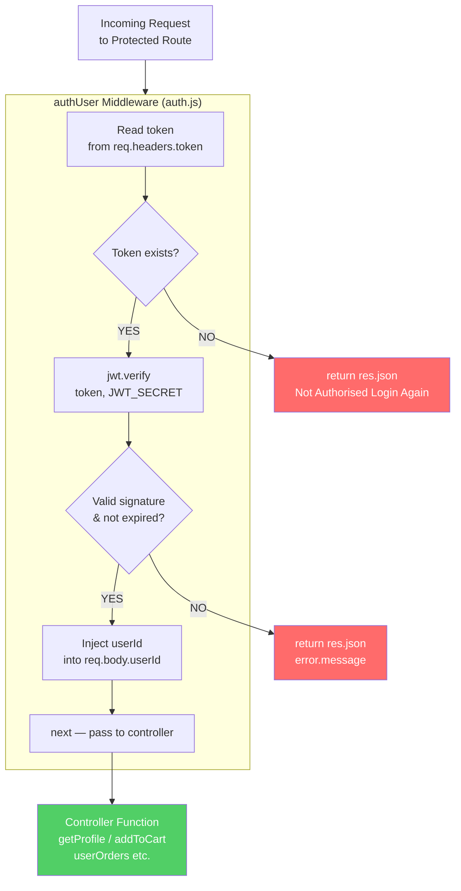

---

## 5. 🛡️ Admin Auth Middleware Flow

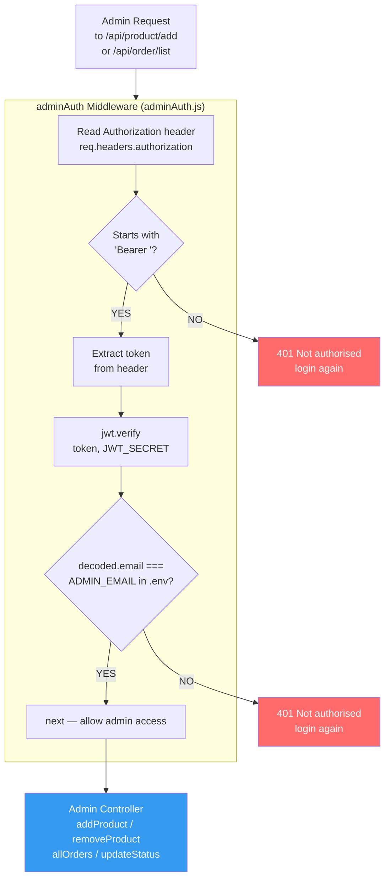

---

## 6. 🛍️ Product Listing & Display Flow

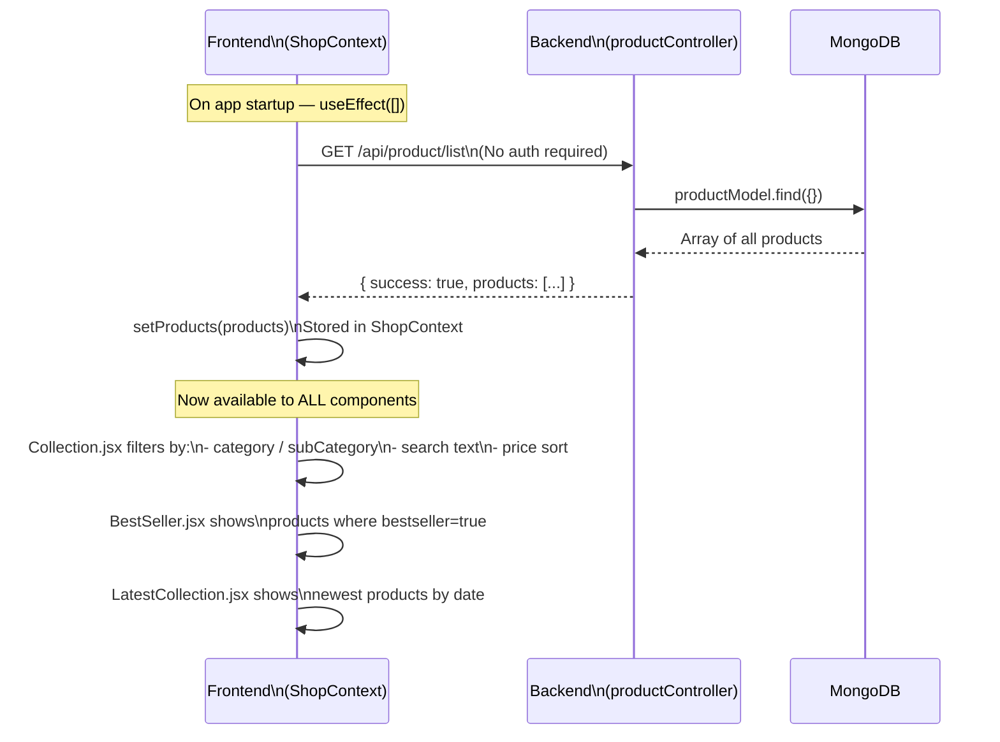

---

## 7. 🖼️ Admin — Add Product Flow

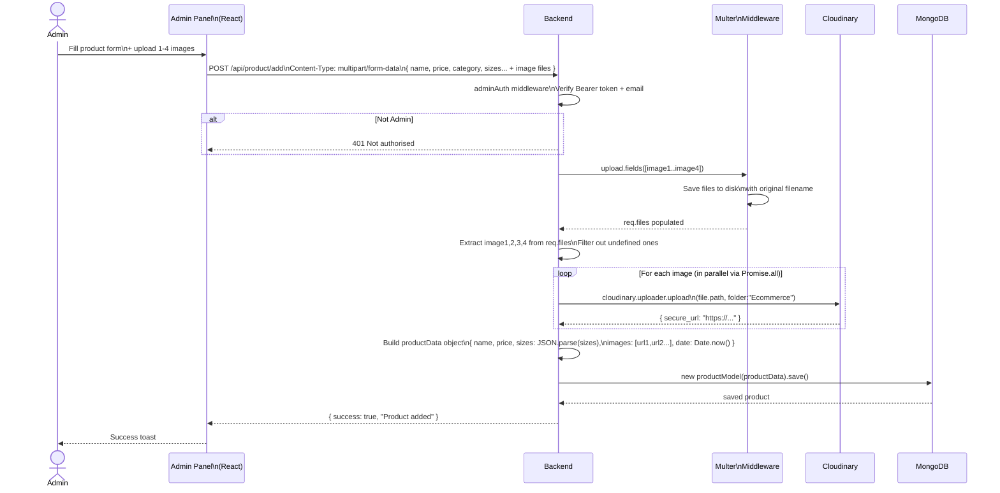

---

## 8. 🛒 Add to Cart Flow

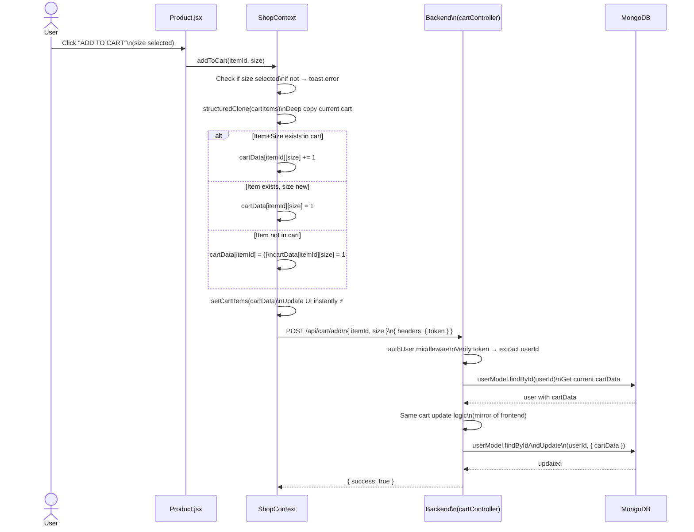

---

## 9. 📦 Place Order — COD Flow

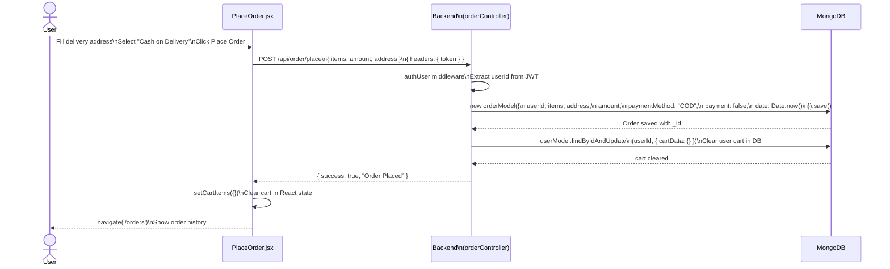

---

## 10. 💳 Place Order — Stripe Payment Flow

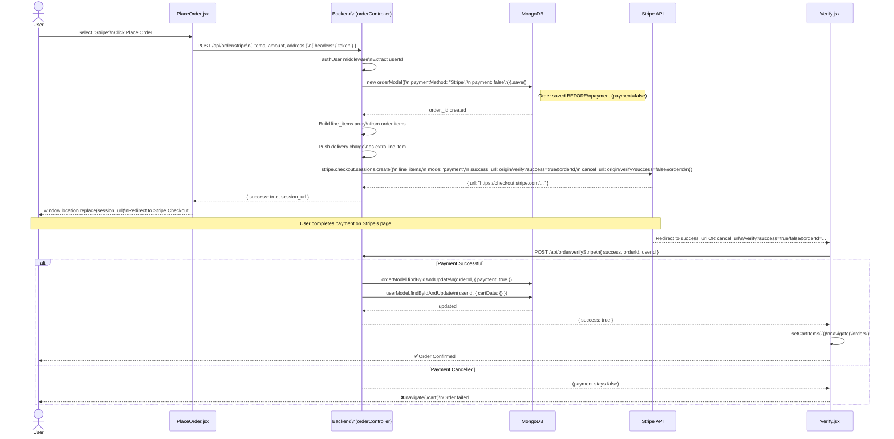

---

## 11. 🔓 Forgot Password & Reset Flow

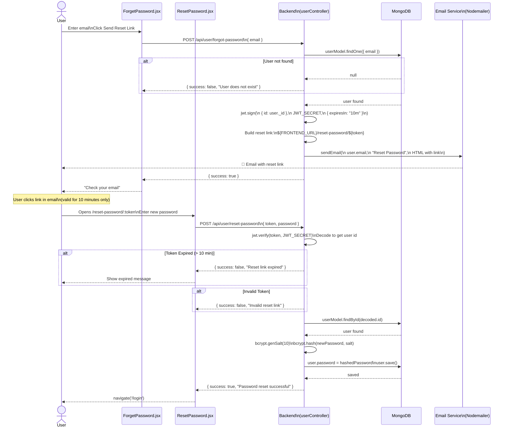

---

## 12. 🤖 Chatbot Pipeline Flow

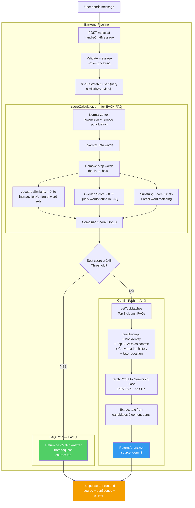

---

## 13. 🔄 Session Restore on Page Reload

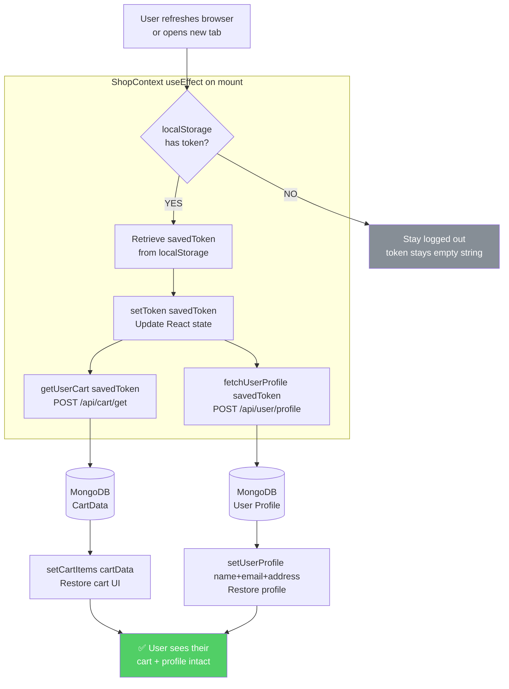

---

## 14. 🗑️ Orphan Cart Cleanup Flow

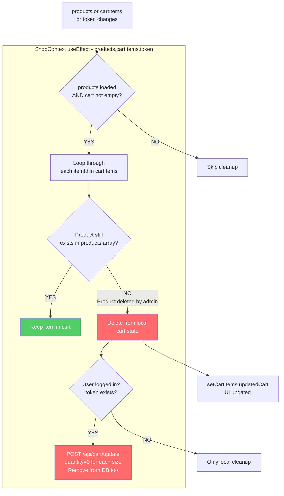
